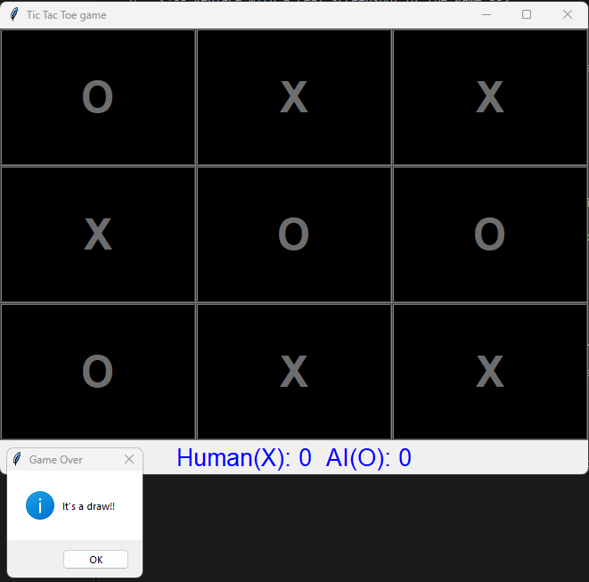

# Tic Tac Toe (Minimax AI)

A classic Tic Tac Toe game with a graphical interface built using Python's standard **Tkinter** library. You play as **X** against an AI opponent (**O**) that uses the **Minimax algorithm**.

  
<!-- Replace with a real screenshot of the game -->

## Features

- Clean, simple GUI with Tkinter, no external libraries required
- AI opponent using the Minimax algorithm
- Live scoreboard tracking Human (X) wins vs AI (O) wins
- Automatic board reset after each round

## Requirements

- **Python 3.x** (Tkinter ships with the standard Python distribution on Windows and macOS)

> **Linux users:** Tkinter may need to be installed separately:
> ```bash
> sudo apt install python3-tk
> ```

No `pip install` needed, this project uses only the standard library.

## Usage

```bash
python tic-tac-toe.py